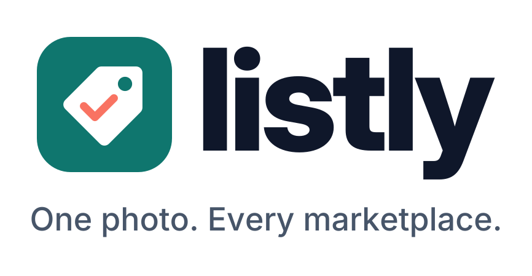

<p align="center"></p>

# Listly

**One photo in, a ready-to-post listing out.** Listly helps second-hand sellers in the Philippines turn a single
photo of an item into honest, ready-to-copy listings for **Facebook Marketplace, Shopee and Carousell**, with a
clean product photo and a price backed by real comparable listings.

Built for the Meta Global AI Developer Hackathon 2026 (Indie Developer track, "Build for Your World").

## Why

Selling preloved items online is a side income for many Filipinos, but every listing means taking a decent photo,
figuring out a fair price, and writing a description three times, once per platform, often in Taglish. Listly does
the busywork. The seller stays in control: they check and edit everything, and **Listly never posts anything**.

## What it does

1. **Identify:** Muse Spark reads any visible logos and labels first, then returns the item, brand, model,
   condition, visible flaws (with where they are), highlights worth mentioning, and a confidence level. It says
   "unknown" rather than guessing a brand, and asks follow-up questions that fit the kind of item (size for shoes,
   battery and charger for gadgets, mileage and OR/CR for vehicles). It refuses prohibited items (weapons, drugs,
   counterfeits, animals).
2. **Cut out:** SAM 3.1 finds the item in the photo and cuts it out of the background.
3. **Clean photo:** Muse Image 1.0 places the cut-out on a clean white background, and is told never to change the
   item or hide its flaws. The original photo is always kept too.
4. **Price:** Muse Spark uses its built-in web search (biased to the Philippines) to find comparable listings and the
   brand-new price, then suggests a range in pesos. **Every source link is checked against the pages the search
   actually returned**, so made-up links are dropped.
5. **Write:** Muse Spark writes a title, description and tags for each platform, in English, Filipino or Taglish,
   following that platform's profile (tone, title length, hashtags). A checker validates each listing in code,
   including that **every flaw is mentioned**, and asks the model to fix it once if needed. The seller can edit by
   hand or just ask: "make it shorter", "add that it comes with the box". Rewrites go through the same checker, so a
   request can't quietly drop a flaw.
6. **Reply to buyers:** paste a buyer's message and set your lowest price; Muse Spark drafts a polite reply. Listly
   double-checks the reply in code and never lets it offer less than your lowest price.

Saved listings live in "My listings" on your own computer (the `data/` folder), with a status (Draft, Listed, Sold) so you can keep track.

## Meta models used

| Model | Used for |
|---|---|
| `muse-spark-1.3` | Identifying the item, price research with built-in `web_search`, writing listings, buyer replies |
| `sam-3.1` | Segmenting the item (one_bit masks, decoded in Python) |
| `muse-image-1.0` | Image-to-image clean product photo |

All calls go through the Meta Model API's Responses endpoint using the `openai` Python SDK.

## Run it yourself

You need Python 3.10+ and your own Meta Model API key. No key? Use demo mode (step 4) or tap **Try a sample listing**.

```bash
git clone <this repo>
cd Listly
python -m venv .venv
# Windows: .venv\Scripts\activate     macOS/Linux: source .venv/bin/activate
pip install -r requirements.txt
cp .env.example .env        # then put your own key in .env: META_API_KEY=...
streamlit run app.py
```

Open the link Streamlit prints (usually http://localhost:8501). On a phone on the same Wi-Fi, use the "Network URL".

**Demo mode:** set `LISTLY_DEMO=1` in `.env` to see the whole flow with sample answers. No key, no API calls, no cost.

## Design choices

- **Saves credits:** photos are shrunk to 1024px before sending, and every model result is cached on disk by image
  hash and step (`cache/`), so re-running the same photo costs nothing.
- **Fails gracefully:** each step can fail on its own. If the cut-out fails, the clean photo uses the full photo; if
  the clean photo fails, the original is still there. Every step has its own "Try again".
- **Model output is validated:** all model replies are JSON, checked into dataclasses (`listly/models.py`); bad
  replies show a friendly error instead of crashing.
- **Private by default:** your API key stays in `.env`, your listings stay in `data/` on your computer, and
  nothing is posted anywhere.

## Project structure

```
app.py               Streamlit UI: home, 3-step new listing, saved listing
.streamlit/config.toml  light and dark theme colours, Inter font
listly/
  identify.py        Muse Spark: item, flaws, follow-up questions
  cutout.py          SAM 3.1 cut-out + one_bit mask decoder
  clean_photo.py     Muse Image clean product photo
  pricing.py         Muse Spark + web search, verified comparables
  writer.py          per-platform listings + checker
  buyer.py           buyer reply helper with a lowest-price guard
  platforms.py       platform profiles (adding a site = adding a profile)
  models.py          dataclasses and validation
  storage.py         saved listings in data/ (JSON + photos)
  ui/theme.py        all custom styling (light and dark)
  ui/components.py   reusable pieces: listing card, badges, step bar, ...
  api.py, cache.py, config.py, images.py, sample.py (3 sample listings)
eval/
  items.csv          test items with known answers (photos go in eval/photos/, not committed)
  run_eval.py        scores identification, condition, flaws and price range
```

## Evaluation

`python eval/run_eval.py` shows how many API calls it would make; add `--yes` to run it. It reports how often the
item is identified, the brand is right (or honestly "unknown" instead of guessed), the condition matches, the known
flaws are found, and the price range overlaps the real one.

## Known limitations

- Facebook Marketplace listings need a login, so web search can't see them; comparables mostly come from public sites
  such as Carousell.
- Platform title limits in `listly/platforms.py` are best-known values and may change.
- Listly runs locally; it isn't hosted.

## Built during the hackathon

Everything in this repository was written during the hackathon building period (from 30 October 2026); see the
commit history.

## Credits

- The SAM 3.1 `one_bit` mask decoder in `listly/cutout.py` is a Python port of Meta's
  [`@meta-sam/parser`](https://www.npmjs.com/package/@meta-sam/parser) (`dist/mask-codec.js`), used under the SAM
  License: see [`third_party/SAM-LICENSE.txt`](third_party/SAM-LICENSE.txt).
- Listly's own code is MIT licensed: see [`LICENSE`](LICENSE).
